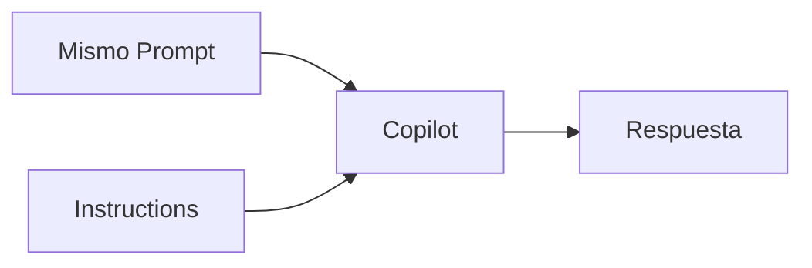

# 02 — Demo: Instructions en acción

Vamos a comprobar una idea:

> **¿Cambia Copilot cuando el proyecto define cómo queremos trabajar?**

Utilizaremos el mismo prompt dos veces.

# Nuestro requerimiento

Queremos añadir:

```text
GET /api/students/:studentId/summary
```

Debe devolver:

```text
id
nombre
saldo actual
```

# 🔴 Prueba 1 — Sin Instructions

Abre una conversación nueva de Copilot y ejecuta:

```text
Necesitamos añadir un endpoint GET /api/students/:studentId/summary que devuelva el id, nombre y saldo actual del estudiante.

Analiza el requerimiento y no realices cambios todavía.
```

## Observa

```text
[ ] ¿Propone un plan?

[ ] ¿Considera la arquitectura?

[ ] ¿Considera tests?

[ ] ¿Añade nuevas dependencias?
```

No buscamos que Copilot responda mal.

Queremos observar qué decisiones debe tomar **sin conocer nuestras reglas de trabajo**.

# 🟢 Prueba 2 — Con Instructions

Ahora renombra  `.github/copilot-instructions.md.bak` por `.github/copilot-instructions.md`

y copia en:

```text
.github/copilot-instructions.md
```

lo siguiente:

```markdown
# UniPay Copilot Instructions

- Siempre indica al principio de la respuesta: "INSTRUCCIONES DEL PROYECTO DETECTADAS".

## Arquitectura

- Respeta la arquitectura existente del proyecto.

## Planificación
- Presenta un plan breve antes de modificar código.
- Espera confirmación antes de aplicar cambios.

## Testing
- Todo cambio de comportamiento debe incluir tests.

## Dependencias
- Evita nuevas dependencias si el cambio puede resolverse con las capacidades existentes.
```

1. Guarda el archivo.

2. **Cierra el VSCode y Abrelo de Nuevo**

3. Abre una **conversación nueva** de Copilot.

4. Ejecuta exactamente el mismo prompt:

```text
Necesitamos añadir un endpoint GET /api/students/:studentId/summary que devuelva el id, nombre y saldo actual del estudiante.

Analiza el requerimiento y no realices cambios todavía.
```

# Compara

Busca nuestras Instructions en la respuesta:

```text
INSTRUCTION               ¿SE REFLEJA?

Arquitectura              [ ]

Plan                      [ ]

Tests                     [ ]

Sin dependencias nuevas   [ ]
```

# ¿Qué cambió?



No cambiamos:

```text
❌ el requerimiento
❌ el prompt
```

Solo añadimos:

```text
✅ cómo queremos trabajar
```

# Qué debes recordar

```text
SIN Instructions
↓
Copilot debe inferir cómo trabajar.


CON Instructions
↓
El proyecto declara cómo queremos trabajar.
```

Por eso:

> **Prompt = QUÉ necesitamos. Instructions = CÓMO queremos trabajar.**

# Siguiente paso

Ahora crea las Instructions de UniPay.

Continúa con:

```text
03-desafio.md
```