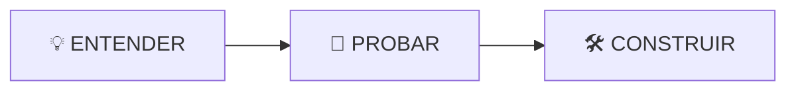

# Módulo 03 — Custom Agent

## 🎯 Objetivo

Construir un especialista capaz de reconocer una misión y elegir cómo abordarla.

## 🧭 Recorrido



### 💡 Entender

Descubrirás qué aporta un Custom Agent.

### 🧪 Probar

Verás al mismo agente frente a:

```text
🛠️ ISSUE
vs.
🚨 INCIDENT
```

### 🛠️ Construir

Crearás:

```text
UniPay SDLC Engineer
```

y definirás una estrategia para cada tipo de misión.

## 🚀 Empecemos

Continúa con:

```text
01-conceptos.md
```