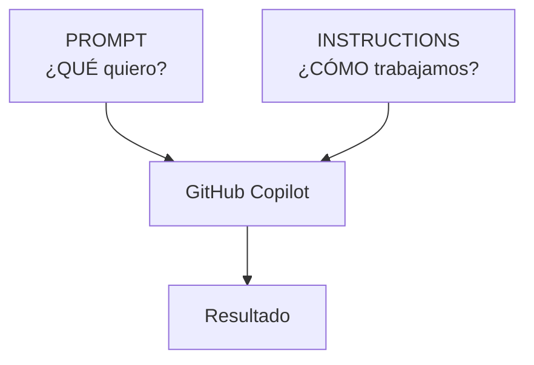

# 01 — ¿Por qué existen las Instructions?

## Imagina esta situación

Le pides a Copilot:

```text
Crea un nuevo endpoint.
```

Pero enseguida añades:

```text
Respeta la arquitectura.

Incluye tests.

No agregues dependencias innecesarias.

Explícame el plan antes de cambiar código.
```

Todo bien.

Hasta que llega la siguiente tarea...

y vuelves a escribir las mismas reglas.

# El problema

Nuestro prompt está mezclando dos cosas:

```text
Crea un nuevo endpoint.
        ↓
       QUÉ


Respeta la arquitectura.
Incluye tests.
Explícame primero el plan.
        ↓
       CÓMO
```

El **QUÉ** cambia con cada tarea.

El **CÓMO** suele permanecer.

# 💡 ¿Y si el proyecto recordara el CÓMO?

Para eso utilizamos **Copilot Instructions**.

En UniPay utilizaremos:

```text
.github/copilot-instructions.md
```

para definir instrucciones que queremos reutilizar dentro del repositorio.



Ahora nuestro prompt puede seguir siendo simple:

```text
Crea un nuevo endpoint.
```

Mientras el repositorio mantiene reglas reutilizables:

```text
Respeta la arquitectura.

Incluye tests.

No agregues dependencias innecesarias.

Presenta un plan antes de cambiar código.
```

---

# La regla que debes recordar

```text
PROMPT
↓
¿Qué quiero hacer?


INSTRUCTIONS
↓
¿Cómo queremos trabajar?
```

# ¿Qué debería ser una Instruction?

Hazte esta pregunta:

> **¿Quiero que Copilot siga esta regla también en la siguiente tarea?**

### ✅ Sí

```text
Presenta un plan antes de modificar código.
```

Es una regla reutilizable.

### ❌ No

```text
Crea GET /api/transfers/:transferId.
```

Es una tarea concreta.

Pertenece al prompt.

# Un detalle más

No todas las Instructions tienen que tener el mismo alcance.

Podemos tener:

```text
.github/copilot-instructions.md
```

para instrucciones del repositorio.

También existen instrucciones específicas para determinados archivos:

```text
.github/instructions/NAME.instructions.md
```

En este laboratorio comenzaremos con las instrucciones generales del repositorio.

# En una frase

> **El Prompt define la tarea. Las Instructions definen cómo queremos trabajar.**

# Ahora vamos a comprobarlo

La pregunta importante es:

> **¿Realmente cambia el comportamiento de Copilot?**

Vamos a utilizar:

```text
EL MISMO PROMPT
```

primero:

```text
SIN Instructions
```

y después:

```text
CON Instructions
```

Continúa con: [02-demo-instructions.md](./02-demo-instructions.md)