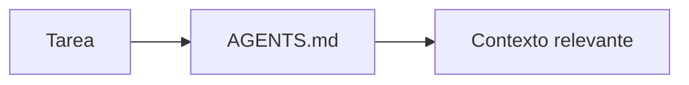
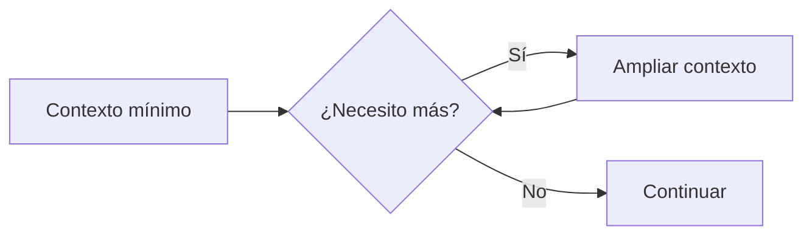

# 01 — ¿Cómo encuentra Copilot el contexto correcto?

En el módulo anterior enseñamos a Copilot:

```text
INSTRUCTIONS
↓
CÓMO queremos trabajar
```

Ahora aparece una nueva pregunta:

> **¿Dónde encuentra el conocimiento que necesita?**

# 📚 El conocimiento está distribuido

UniPay tiene distintas fuentes:

```text
docs/
├── architecture.md
├── business-rules.md
├── api-guidelines.md
├── testing-guidelines.md
├── error-catalog.md
└── tickets/

openapi.yaml
```

Dependiendo de la tarea, Copilot necesitará consultar información diferente.

# 💡 AGENTS.md

**AGENTS.md es un mapa que ayuda al agente a descubrir dónde encontrar el conocimiento del proyecto.**

Por ejemplo:

```text
Arquitectura
↓
docs/architecture.md


Reglas de negocio
↓
docs/business-rules.md


API
↓
docs/api-guidelines.md
openapi.yaml


Testing
↓
docs/testing-guidelines.md
```



# 🤔 ¿Y debemos cargar todo?

No.

Una tarea de API podría comenzar únicamente con:

```text
docs/api-guidelines.md
openapi.yaml
```

Y ampliar el contexto después si lo necesita.

# 💡 Progressive Disclosure

**Progressive Disclosure es una técnica que empieza con el contexto mínimo y añade más información solo cuando es necesaria.**



# ⭐ Qué debes recordar

```text
AGENTS.md
↓
¿DÓNDE está el conocimiento?


PROGRESSIVE DISCLOSURE
↓
¿QUÉ contexto necesito AHORA?
```

> **No necesitamos cargar todo el conocimiento. Necesitamos encontrar el conocimiento adecuado en el momento adecuado.**

# 🧪 Vamos a comprobarlo

Compararemos:

```text
🔴 SIN AGENTS.md
        VS.
🟢 CON AGENTS.md
```

y veremos cómo Copilot puede ampliar el contexto progresivamente.

Continúa con:

```text
02-demo-contexto.md
```