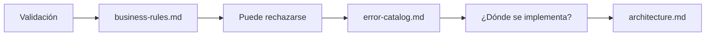

# 02 — Demo: contexto en acción

## 🎯 Objetivo

Vamos a comprobar:

```text
AGENTS.md
↓
¿DÓNDE buscar?


PROGRESSIVE DISCLOSURE
↓
¿CUÁNTO contexto necesito
y CUÁNDO ampliarlo?
```

Durante la demo:

```text
✅ Mantén copilot-instructions.md sin cambios.

✅ Utiliza un chat nuevo para cada experimento.
```

# 🧪 Experimento 1 — AGENTS.md

Usaremos la misma tarea y el mismo prompt.

Solo cambiaremos:

```text
🔴 AGENTS.md vacío

vs.

🟢 AGENTS.md con un mapa mínimo
```

## 🔴 Prueba A — Sin AGENTS.md

Abre:

```text
AGENTS.md
```

Déjalo vacío y guarda el archivo.

Abre un chat nuevo con Copilot.

Ejecuta:

```text
Necesitamos revisar una validación relacionada con transferencias.

¿Qué documento del proyecto consultarías primero?

No propongas una solución.
```

### 👀 Observa

```text
¿Dónde decidió buscar Copilot?
```

No buscamos que Copilot se equivoque.

Queremos observar cómo encuentra el contexto sin un mapa explícito.

## 🟢 Prueba B — Con AGENTS.md

Copia este contenido en:

```text
AGENTS.md
```

```markdown
# UniPay Agent Guide

Utiliza este archivo como mapa para descubrir el conocimiento del proyecto.

Consulta únicamente el contexto necesario y amplíalo cuando aparezca una nueva necesidad.

## Reglas de negocio

Para transferencias, balances y validaciones, consulta:

- `docs/business-rules.md`

## Errores

Para operaciones rechazadas y códigos de error, consulta:

- `docs/error-catalog.md`

## Arquitectura

Para comprender la estructura y las responsabilidades entre capas, consulta:

- `docs/architecture.md`
```

Guarda el archivo.

Abre un chat nuevo y ejecuta exactamente el mismo prompt:

```text
Necesitamos revisar una validación relacionada con transferencias.

¿Qué documento del proyecto consultarías primero?

No propongas una solución.
```

### 🔎 Busca evidencia

Busca evidencia de que Copilot identifica:

```text
docs/business-rules.md
```

No evaluamos si la segunda respuesta es mejor.

Evaluamos si ahora existe una guía explícita sobre dónde buscar.

## ⭐ ¿Qué aprendimos?

```text
SIN AGENTS.md
↓
Copilot debe descubrir o inferir dónde buscar.


CON AGENTS.md
↓
Copilot dispone de un mapa explícito.
```

# 🧪 Experimento 2 — Progressive Disclosure

Mantén el `AGENTS.md` configurado.

Continúa en el mismo chat de la Prueba B.

Ya comenzamos con:

```text
docs/business-rules.md
```

Ahora ampliaremos el contexto solo cuando aparezca una nueva necesidad.

## 1️⃣ La operación puede ser rechazada

Ejecuta:

```text
La validación puede provocar el rechazo de la transferencia.

¿Qué único documento adicional consultarías?

No propongas una solución.
```

Busca evidencia de que identifica:

```text
docs/error-catalog.md
```

## 2️⃣ Necesitamos localizar la responsabilidad

Continúa:

```text
Ahora necesitamos saber en qué capa debería implementarse.

¿Qué único documento adicional consultarías?
```

Busca evidencia de que identifica:

```text
docs/architecture.md
```

## 🔎 Observa la progresión



El contexto creció conforme apareció una nueva necesidad.

No cargamos todos los documentos al principio.

# ⭐ Qué debes recordar

```text
AGENTS.md
↓
DÓNDE buscar


PROGRESSIVE DISCLOSURE
↓
CUÁNTO contexto necesito
y CUÁNDO ampliarlo
```

> **AGENTS.md nos indica dónde buscar. Progressive Disclosure nos ayuda a ampliar el contexto cuando aparece una nueva necesidad.**

# 🧹 Antes de continuar

El `AGENTS.md` usado en esta demo es solo un ejemplo mínimo.

Vacía nuevamente:

```text
AGENTS.md
```

En el siguiente desafío construirás el mapa completo de UniPay.

# 🚀 Tu turno

Continúa con:

```text
03-desafio.md
```