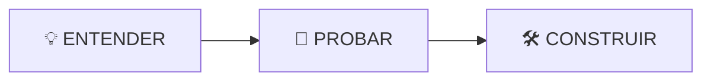

# Módulo 02 — AGENTS.md y Progressive Disclosure

## 🎯 Objetivo

Aprender a guiar a Copilot hacia el conocimiento adecuado sin cargar toda la documentación del proyecto.

## 🧭 Recorrido



### 💡 Entender

Descubrirás por qué un agente necesita un mapa para navegar el conocimiento de UniPay.

### 🧪 Probar

Compararás el mismo escenario:

```text
🔴 SIN AGENTS.md
       VS.
🟢 CON AGENTS.md
```

Después comprobarás cómo el contexto puede ampliarse solo cuando sea necesario.

### 🛠️ Construir

Crearás y probarás el `AGENTS.md` de UniPay.

## ⭐ Al finalizar

Podrás explicar:

```text
AGENTS.md
↓
¿DÓNDE está el conocimiento?


PROGRESSIVE DISCLOSURE
↓
¿QUÉ contexto necesito ahora?
```

## 🚀 Empecemos

Continúa con: [01-concepto.md](./01-concepto.md)