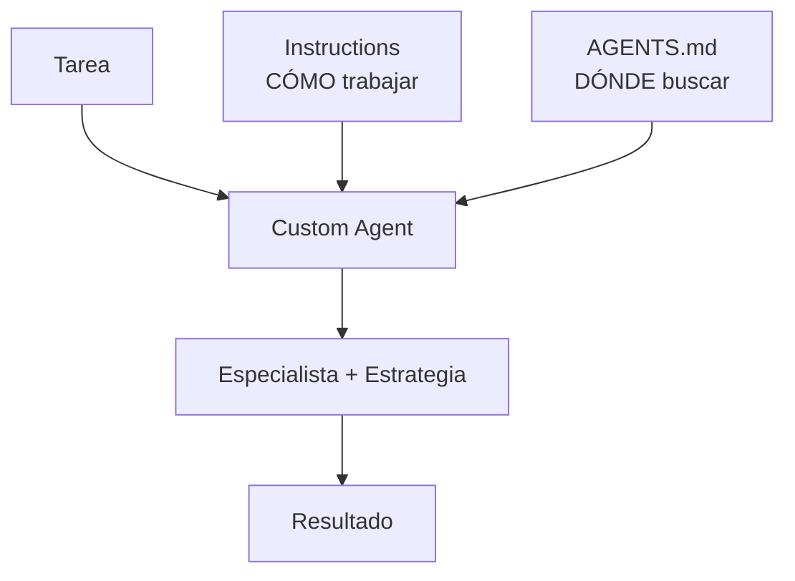
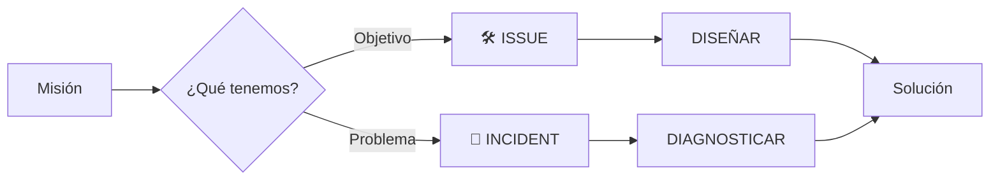

# 01 — ¿Y si Copilot tuviera un especialista?

Ya hemos preparado UniPay con:

```text
INSTRUCTIONS
↓
CÓMO trabajar


AGENTS.md
↓
DÓNDE buscar
```

Y con Progressive Disclosure podemos ampliar el contexto cuando lo necesitamos.

Pero todavía somos nosotros quienes dirigimos el proceso.

---

# 🤔 Falta una pieza

Ante cada tarea seguimos diciendo:

```text
Entiende el problema.

Busca contexto.

Revisa el código.

Decide qué hacer.

Implementa.

Valida.
```

> **¿Y si pudiéramos convertir ese proceso en un especialista reutilizable?**

---

# 💡 Custom Agent

Un **Custom Agent** es una configuración reutilizable especializada en un rol o tipo de trabajo.

En VS Code, un Custom Agent puede definir su comportamiento, herramientas y opcionalmente el modelo que utiliza. En este laboratorio nos centraremos en algo más sencillo: **su especialidad y su estrategia de ejecución**. 【1-3e1690】【2-745157】

Crearemos:

```text
UniPay SDLC Engineer
```

en:

```text
.github/agents/unipay-sdlc-engineer.agent.md
```

---

# 🧠 ¿Qué aporta?

El Custom Agent no reemplaza lo anterior.



Cada pieza tiene su responsabilidad:

```text
INSTRUCTIONS
↓
Reglas de trabajo


AGENTS.md
↓
Mapa de conocimiento


CUSTOM AGENT
↓
Especialista + Estrategia
```

---

# 🔀 Pero no todas las misiones son iguales

Nuestro especialista trabajará con dos tipos.

---

## 🛠️ ISSUE

Un Issue nos dice:

> **Qué queremos construir o cambiar.**

Por ejemplo:

```text
Añadir un endpoint para consultar
una transferencia por su id.
```

Aquí conocemos el objetivo.

Necesitamos descubrir:

```text
¿Cómo lo diseñamos?
```

Por eso la estrategia será:

```text
ENTENDER
   ↓
CONTEXTO
   ↓
INSPECCIONAR
   ↓
DISEÑAR
   ↓
IMPLEMENTAR
   ↓
VALIDAR
```

---

## 🚨 INCIDENT

Un Incident nos dice:

> **Qué comportamiento está fallando.**

Por ejemplo:

```text
Una operación está produciendo
un resultado incorrecto.
```

Conocemos el síntoma.

Pero todavía necesitamos descubrir:

```text
¿Por qué está ocurriendo?
```

Por eso la estrategia cambia:

```text
ENTENDER
   ↓
CONTEXTO
   ↓
REPRODUCIR
   ↓
DIAGNOSTICAR
   ↓
CORREGIR
   ↓
VALIDAR
```

---

# ⚖️ La diferencia



Recuerda:

```text
ISSUE
↓
Sé QUÉ quiero conseguir
↓
DISEÑO cómo hacerlo


INCIDENT
↓
Sé QUÉ está fallando
↓
DIAGNOSTICO por qué
```

---

# ⭐ Qué debes recordar

```text
CUSTOM AGENT
↓
ESPECIALISTA + ESTRATEGIA
```

El mismo especialista puede elegir una estrategia distinta según la misión:

```text
ISSUE
↓
Diseñar


INCIDENT
↓
Diagnosticar
```

> **Instructions definen reglas. AGENTS.md guía hacia el conocimiento. El Custom Agent decide cómo abordar la misión.**

---

# 🧪 Vamos a comprobarlo

Utilizaremos:

```text
EL MISMO AGENTE
```

con:

```text
🛠️ ISSUE
   VS.
🚨 INCIDENT
```

La pregunta será:

> **¿Puede el mismo especialista reconocer la misión y seleccionar la estrategia adecuada?**

Continúa con:

```text
02-demo-agent.md
```