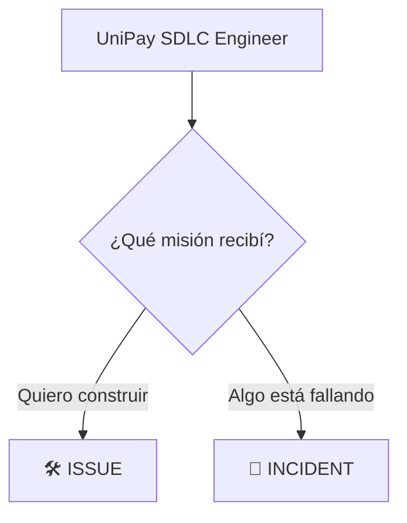

# 02 — Demo: un especialista, dos misiones

## 🎯 Objetivo

Vamos a comprobar si el mismo especialista puede reconocer diferentes tipos de misión.

```text
MISMO AGENTE
+
DOS MISIONES
```

# 🛠️ Prepara el agente

Abre:

```text
.github/agents/unipay-sdlc-engineer.agent.md
```

Copia este agente de demostración:

```markdown
---
name: unipay-sdlc-engineer
description: Especialista de demostración para clasificar misiones de UniPay.
target: vscode
---

# Misión

Clasifica la misión recibida.

Si debemos crear o modificar una capacidad:

MISIÓN: ISSUE

Si debemos investigar un comportamiento defectuoso:

MISIÓN: INCIDENT

Antes de realizar cambios responde:

MISIÓN:
MOTIVO:
SIGUIENTE PASO:
```

Guarda el archivo.

Selecciona en GitHub Copilot:

```text
unipay-sdlc-engineer
```

# 🧪 Prueba 1 — Nueva capacidad

Abre un chat nuevo y ejecuta:

```text
Necesitamos añadir un endpoint GET /api/transfers/:transferId para consultar una transferencia por su identificador.

Identifica la misión.

No realices cambios.
```

## 🔎 Observa

Busca:

```text
MISIÓN
↓
ISSUE
```

¿Por qué?

```text
Sabemos QUÉ queremos construir.
```

# 🧪 Prueba 2 — Algo está fallando

Abre otro chat nuevo con el mismo agente.

Ejecuta:

```text
Se ha reportado que la consulta de una transferencia devuelve información incorrecta.

Identifica la misión.

No investigues ni realices cambios.
```

## 🔎 Observa

Busca:

```text
MISIÓN
↓
INCIDENT
```

¿Por qué?

```text
Sabemos QUÉ está fallando,
pero todavía no sabemos POR QUÉ.
```

# ⚖️ Compara



El especialista es el mismo.

La misión cambia.

# 💡 Pero todavía falta algo

Nuestro agente ya puede reconocer:

```text
ISSUE
```

y:

```text
INCIDENT
```

Pero todavía no sabe:

> **¿Qué estrategia debe ejecutar para cada misión?**

Por ejemplo:

```text
ISSUE
↓
¿cómo paso del objetivo a una solución?


INCIDENT
↓
¿cómo paso del problema a una causa raíz?
```

Eso será tu desafío.

# 🧩 Recuerda cómo se conectan las piezas

```text
INSTRUCTIONS
↓
CÓMO trabajar


AGENTS.md
↓
DÓNDE buscar


CUSTOM AGENT
↓
ESPECIALISTA + ESTRATEGIA
```

El Custom Agent no reemplaza las piezas anteriores.

Las utiliza para ejecutar su misión.

# ⭐ Qué debes recordar

```text
ISSUE
↓
Tengo un objetivo


INCIDENT
↓
Tengo un problema
```

Ahora necesitamos enseñar al especialista **qué estrategia utilizar en cada caso**.

# 🧹 Antes de continuar

El agente utilizado en esta demo es solo un ejemplo para aprender a clasificar misiones.

Vacía nuevamente:

```text
.github/agents/unipay-sdlc-engineer.agent.md
```

# 🚀 Tu turno

Ahora construirás el verdadero:

```text
UniPay SDLC Engineer
```

Continúa con: [03-desafio.md](./03-desafio.md)
