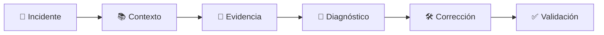

# 🏆 Final Boss — UL-102

Has construido todas las piezas.

Ahora vamos a utilizarlas juntas sobre una misión real.

# 🚨 Tu misión

Existe un incidente en UniPay:

```text
UL-102
```

Selecciona:

```text
UniPay SDLC Engineer
```

Abre un chat nuevo y ejecuta únicamente:

```text
Investiga y resuelve UL-102.
```

No añadas pistas.

Deja que el agente descubra cómo abordar la misión.

# 👀 Observa

Comprueba si el agente consigue:

```text
[ ] Reconocer la misión como INCIDENT.

[ ] Descubrir el contexto necesario.

[ ] Reproducir el problema.

[ ] Identificar la causa raíz.

[ ] Corregir el problema.

[ ] Validar el resultado.
```

# 🔎 Revisa la evidencia

Al finalizar deberías poder responder:

```text
¿Qué contexto utilizó?

¿Qué problema reprodujo?

¿Cuál fue la causa raíz?

¿Qué cambió?

¿Cómo validó la solución?
```

# 🏁 Misión completada

El objetivo no es solamente:

```text
BUG CORREGIDO ✅
```

El objetivo es conseguir una solución trazable:



# ⭐ Lo que construiste

```text
PROMPT
↓
QUÉ


INSTRUCTIONS
↓
CÓMO


AGENTS.md
↓
DÓNDE


PROGRESSIVE DISCLOSURE
↓
CUÁNTO + CUÁNDO


CUSTOM AGENT
↓
ESTRATEGIA
```

> **No construiste un prompt más grande. Construiste un entorno para que un agente pueda tomar mejores decisiones de ingeniería.**